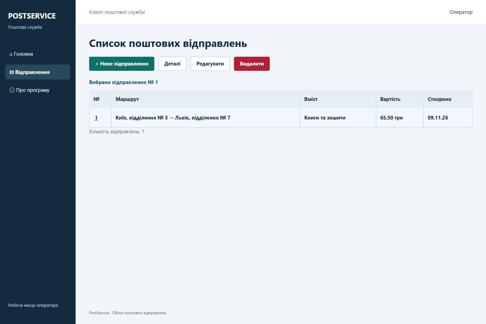

# Облік поштових відправлень

Вебклієнт PostService за макетами ПР-44. Головна сторінка веде до списку та розділу «Про програму». У списку можна вибрати відправлення, відкрити деталі, створити або змінити запис і видалити його після підтвердження.

[Звіт Word](reports/PostService-web-report.docx) · [Журнал збірки](reports/build-results.txt) · [Перевірки API](reports/api-checks.txt)

## Як запустити

Встановіть .NET SDK 10. У PowerShell з кореня репозиторію виконайте:

```powershell
dotnet build PostServiceSolution/PostService.slnx -warnaserror
dotnet run --project PostServiceSolution/PostService/PostService.csproj --no-build
```

Відкрийте [http://localhost:5211](http://localhost:5211). PostService роздає сторінку і приймає HTTP-запити на цій самій адресі. Під час першого запуску в каталозі проєкту автоматично створюється файл SQLite `PostingDb.db`.

Щоб додати три приклади в порожню базу, залиште сервер запущеним та виконайте в другому вікні PowerShell:

```powershell
./scripts/Add-DemoData.ps1
```

## Демонстрація

1. Відкрийте список із головної сторінки. Для перегляду деталей виберіть відправлення.
2. Натисніть «Нове відправлення» та спробуйте зберегти форму з вагою 0 кг. Форма покаже помилки біля полів.
3. Заповніть обов’язкові поля, збережіть і перевірте новий рядок. Ціну нового відправлення розрахує сервер.
4. Виберіть запис і натисніть «Редагувати». Змініть вміст або вартість та збережіть. Для перевірки скасування повторно відкрийте форму, змініть поле і натисніть «Скасувати».
5. Для тестового запису натисніть «Видалити» й підтвердьте дію. Список оновиться після відповіді сервера.
6. Зменште ширину вікна. Список перейде від таблиці до карток, а підказки з’являться під полями.

## Будова

- `PostServiceSolution/PostService/wwwroot` містить HTML, CSS і три модулі JavaScript. `app.js` керує екранами, `api.js` виконує запити, `posting-form.js` перевіряє поля спільної форми.
- `GET /postings` повертає список, `GET /postings/{id}` завантажує запис, `POST /postings` створює його, `PUT /postings/{id}` зберігає зміни, `DELETE /postings/{id}` видаляє.
- У формі обов’язкові відправник, отримувач, вміст, тип доставки, вага та габарити. Вага має бути більшою за 0 і не більшою за 1 000 000 кг. Габарити мають бути додатними, оголошена цінність і ціна під час редагування — невід’ємними. Числові поля приймають кому або крапку.

У браузері перевірено переходи, порожній список, валідацію, створення, деталі, редагування, скасування та діалог видалення. Видалення перевірено запитом до API в окремій тестовій базі. Стан після перезапуску також перевірено. Усі 19 серверних перевірок пройшли.

```powershell
dotnet run --project Checks/DatabaseChecks.csproj -- --api-dll PostServiceSolution/PostService/bin/Debug/net10.0/PostService.dll
```


